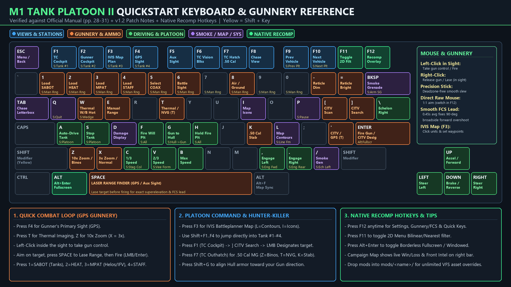

# M1 Tank Platoon II — Native Modernization & Modding Runtime (`m1tp2-native`)

A **100% native SDL3 + OpenGL 3.3 Core + Dear ImGui** modernization, HD renderer, True Hor+ widescreen patch, gunnery/FCS overhaul, GUI launcher, and modding framework for MicroProse's **M1 Tank Platoon II (1998)** on modern Windows (Windows 10 / 11).

**Zero third-party compatibility wrappers required** — no DxWnd, no DDrawCompat, no dgVoodoo2.

> **Note:** This repository contains **no copyrighted game assets or original executables**. You must own a legal copy of *M1 Tank Platoon II* (e.g., from GOG.com or retail CD v1.2).

---

## Features

- **Native GUI Launcher (`m1tp2_native.exe`)**:
  - Clean **SDL3 + OpenGL 3.3 + Dear ImGui** startup launcher (with `--launcher`, `--no-launcher` / `--play`, and `--war-college` / `-w` CLI flags) with **proportional window scaling** and crisp high-res TrueType fonts (`segoeui.ttf` @ 28px) that scale smoothly when maximized on 1440p / 21:9 / 4K displays.
  - Side-by-side Launch Cards for **M1 Tank Platoon II** (automatically bypasses Windows 11's broken `sysmain.sdb` `EmulateHeap` shim via an NTFS hardlink `M1TP2_bin.exe`) and **War College / DSG** (`Dsg\OMOPLAY.EXE` via `otvdmw.exe` or GOG's bundled BoxedWine with no console flash).
  - Built-in **Manuals & Quickstart Reference Bar**: 1-click links to your local **Official Game Manual (`M1_Tank_Platoon_II_Manual.pdf`)**, **v1.2 Patch Notes (`M1TP2Readme.txt`)**, **Original ReadMe**, **`mods/` Folder**, and an embedded full-window **Quickstart Keyboard & Gunnery Layout** image viewer (`docs/M1TP2_Quickstart_Keys.png`) with `Fit / 100% / 125% / 150%` zoom and trilinear mipmaps.
  - Comprehensive 2-tab **Pre-Launch Settings** panel synced 2-way with `m1tp2_recomp.ini` and `game.cfg`: Graphics & Widescreen, **4-Channel Audio Mixer**, Gunnery/FCS, Joystick Disable, 100 FPS Mode, Runtime/Campaign toggles, Advanced Filters, and stock `game.cfg` controls (Sound, Detail, Alpha Blending, Renderer, Player/Host Name).
- **High-Precision 100 FPS Frame Pacing & Native 4-Channel Audio Mixer**:
  - Replaces M1TP2's 1998 `GetTickCount() / 10` timer (`0x438CB0`, 15.625 ms quantum) and `>= 20 ms` frame cap (`0x41E386`) with a microsecond `QueryPerformanceCounter` timer and **100 FPS Mode** (72 FPS with 144 Hz VSync, 100 FPS with VSync off / G-Sync VRR) while preserving authentic `1x` simulation speed.
  - Hooks `MPSSNDR.DLL` (`0x449C10` / `0x449C60` / `0x449CF0`) for a live logarithmic dB **Audio Mixer** (`Master`, `Music`, `Weapons/SFX`, `Engines & Tracks`, `Crew Radio / Voice`, and `Mute All`) in both the Launcher and `F12` Overlay.
- **Native HD OpenGL 3.3 Glide Renderer, Cockpit HUD Parity & Extended Draw Distance**:
  - Implements all 32 Glide 2.43 functions natively in OpenGL 3.3 at your **native monitor resolution** (1080p / 1440p / 21:9 / 4K), including full Glide `GR_ASPECT_8x1..1x8` non-square texture aspect ratios, bounds-guarded texture uploads, and hardware-exact post-LFB `grDrawLine`/`grDrawPoint` rasterization (restoring the GPS/GAS tank hull & turret indicator dial and TC CITV lines).
  - Hardware **MSAA** (up to 8x), **Anisotropic Filtering** (up to 16x), **Trilinear Mipmaps** with neighbor-RGB chromakey edge bleeding, **Extended Draw Distance & Terrain LOD** (`2.0 km / 3.0 km / 4.0 km / 6.0 km` with matching 1x–4x terrain LOD & auto-scaled fog), and live gamma control.
  - Automatically redirects Direct3D selection in `game.cfg` into Native Glide HD.
- **True Hor+ Widescreen 3D + Smart Per-View Auto-Aspect**:
  - Hooks M1TP2's 3D projection (`0x459A5D`), frustum classifier (`0x4599ED`), and 3DZ bounding-sphere culler (`0x44DF1D`, replacing 1998's overflowing 32-bit `shl eax, 9` check with 64-bit sphere-plane math) for **true Hor+ widescreen** (zero stretching, zero left/right edge pop-out even on 21:9 / 32:9 ultrawides).
  - **Smart Auto-Aspect** (default):
    - **TC Outhatch `.50 cal` (`F7`)**, **Chase View (`F8`)**, and **External Views** render full-screen edge-to-edge in True Hor+ widescreen while keeping the `.50 cal` grips, cursor, and HUD text un-stretched in a centered 4:3 safe zone.
    - **Tactical Map / Battleplanner (`F3`)** is **Auto Aspect-Native (4:3)** by default so the 10 km × 10 km square map never stretches on 16:9 or 21:9 ultrawide displays (with optional capped `16:10`, capped `16:9`, or `Stretch Fill` modes in `F12`).
    - **Interior Cockpits (`F1`/`F2`)**, **GPS Sight (`F4`)**, **Circular GAS Tube (`F5`)**, **Vision Blocks (`F6`)**, and **2D Menus/Briefings** stay crisp **4:3**.
- **Gunner Sight Mouse Precision, Joystick Disable & 90° Broadside FCS Fix**:
  - **Precision Stick (Default)** eliminates M1TP2's `640×480` quantization and 10x-zoom `÷8` integer-truncation deadzone (~75px at 1080p) using sub-pixel floating-point tracking and fractional turret accumulation (`0x43594F`, `0x41705D`, `0x41728C`) with adjustable sensitivity (`0.25x–3.00x`).
  - **Direct Raw Mouse** option uses raw SDL relative mouse deltas for 1:1 aiming (capped to the real M1A2's ~42°/s turret slew rate).
  - **Disable Joystick / Gamepad (Default: On)** intercepts WinMM joystick IAT calls (`joyGetPosEx` / `joyGetDevCapsA`) so plugged-in HOTAS/pedals/gamepads never cause unwanted turret or steering drift unless you want them enabled.
  - **Smooth FCS Lead (Default)** hooks `SpawnBallisticShell` (`0x406B74`) to replace M1TP2's unclamped single-frame `turretDeltaYaw` spike with a **0.45s exponential moving average** + `35 m/s` cross-speed clamp — fixing the classic 90° broadside overshoot while driving (with **Manual / No Auto-Lead** and **Stock 1998** modes also available in `F12`).
- **Dear ImGui In-Game Settings Overlay (`F12` or `Insert`)**:
  - Full top menu bar (`Game`, `3D / Display`, `Audio Mixer`, `Gunnery & FCS`, `Campaign & Mods`, `Quick Keys`, `Stats / Debug`) with an always-visible software cursor, live telemetry, zoomable in-game Quickstart Keyboard image viewer, direct manual/War College launchers, and instant save to `m1tp2_recomp.ini`.
- **Stability & Crash Diagnostics**:
  - Hooks M1TP2's VC5 `crt_free` (`0x45C730`) alongside `TrackedAlloc` to prevent cross-heap frees when exiting the Configuration menu, plus a Vectored Exception Handler that rotates `m1tp2_recomp.prev.log` and appends full module+RVA stack traces to `m1tp2_crash.log`.
- **Dynamic Campaign AI-Front Bugfix & Live Campaign Intel HUD**:
  - Fixes a genuine 1998 MicroProse bug in `SimulateOtherFronts` (`0x42A395`) that forgot to divide your permille win score (`0..1000`) by `10` when simulating the other 3 AI fronts — restoring a genuine strategic tug-of-war across the theater (toggleable live in `F12`).
  - Displays a sleek **Campaign Intel Sidebar** in the unused 16:9 right margin on Campaign Map & Briefing screens showing your exact **Winning / Contested / Losing** status, **Win-Rate Gauge** vs. the hidden checkpoint thresholds, **Battles & Hours Clock**, and live progress bars for all 4 theater fronts (`RED`, `GRN`, `YEL`, `BLU`).
- **Native Modding VFS (`mods/`), JSON Unit Overrides & Asset Toolkit (`tools/m1tp2_modtool.py`)**:
  - Hooks `CatalogLookup` (`0x427120`) and `crt_fopen` (`0x45C560`) so loose files in `mods/<mod_name>/` override **any asset** in `Game\m1.cat`, `Game\3dz.cat`, or loose `BATTLES\`, `World\`, `Cockpits\`, `Campaign\`, and `SOUND\` folders — with **no 255-entry `over.txt` limit** and no edits to stock archives.
  - Supports live **JSON Unit & Ballistics Balance Overrides** (`mods/<mod>/units.json`) across all 94 embedded vehicle/unit definitions (`0x479A80`).
  - Included Python 3 CLI (`tools/m1tp2_modtool.py`) unpacks/repacks `.cat` archives (automatically recovering **94.8%** of `3dz.cat` and **90.6%** of `m1.cat` filenames), exports `.3dz` 3D tank models with UVs to Blender-ready `.obj`/`.mtl`, and dumps all 94 unit structs to JSON.

---

## Quickstart Keyboard Layout



---

## Quick Install (End Users)

1. Install your owned copy of **M1 Tank Platoon II** (GOG.com or retail v1.2).
2. Download **`M1TP2-Native-Setup-v0.3.0.exe`** from the [Releases](https://github.com/ajalberd/m1tp2-native/releases) page.
3. Run the installer — it automatically detects your M1TP2 folder, backs up any old `ddraw.dll` / DDrawCompat files to `_m1tp2_backup\`, installs the native runtime & Quickstart Keyboard Layout, configures Glide HD mode, and creates a Desktop shortcut.
4. Launch via **`m1tp2_native.exe`** (or the Desktop shortcut) to open the **Native Launcher**. Press **`F12`** in-game anytime to tune display, audio mixer, gunnery/FCS, campaign, mods, or view Quick Keys!

> **Portable / Manual Install:** Download `M1TP2-Native-v0.3.0-portable.zip`, back up any existing `ddraw.dll` (e.g. GOG's DDrawCompat), extract the ZIP into your M1TP2 root folder (next to `M1TP2.exe`), and run `m1tp2_native.exe`.

> **Silent CLI Install / Uninstall:**
> ```powershell
> .\M1TP2-Native-Setup-v0.3.0.exe /S /D="C:\GOG Games\M1 Tank Platoon II"
> .\M1TP2-Native-Setup-v0.3.0.exe /U /D="C:\GOG Games\M1 Tank Platoon II"
> ```

---

## Modding Quick Start

Drop modified files into `mods\<your_mod>\` inside your M1TP2 folder:
- Archive overrides (`m1.cat` / `3dz.cat`): `mods\my_mod\3dz\...`, `mods\my_mod\pics\...`, `mods\my_mod\vpics\...`, `mods\my_mod\cockpits\...`
- Disk overrides: `mods\my_mod\BATTLES\...`, `mods\my_mod\World\...`, `mods\my_mod\Cockpits\cockpit.dat`, `mods\my_mod\Game\battle.txt`
- Unit & Ballistics JSON overrides: `mods\my_mod\units.json`
- Optional `mods\loadorder.txt` controls load priority (one folder name per line; later overrides earlier).

Use `tools/m1tp2_modtool.py` (Python 3, stdlib only) to inspect/unpack/export game assets:
```powershell
python tools\m1tp2_modtool.py cat-list m1.cat --filter m1a2
python tools\m1tp2_modtool.py cat-unpack m1.cat .\unpacked --filter m1a2
python tools\m1tp2_modtool.py 3dz-to-obj bmp2_h.3dz .\bmp2_h.obj
python tools\m1tp2_modtool.py dump-units M1TP2.exe .\units_stock.json
python tools\m1tp2_modtool.py new-mod my_first_mod
```

---

## Building from Source

### Prerequisites
- Windows (x64 or x86)
- [Zig 0.14.x](https://ziglang.org/download/) (`zig` in `PATH`, or pass `-ZigExe`)
- PowerShell 5.1+ (built into Windows)
- Python 3 (only needed when running `package_release.ps1` to bundle the 1-shot installer)

### Build Commands
```powershell
# Auto-downloads SDL3 3.4.20, Dear ImGui 1.91.8, and stb_image.h on first build into .\third_party\
.\build.ps1

# Optional: build AND stage directly into your M1TP2 install folder
.\build.ps1 -GameDir "C:\GOG Games\M1 Tank Platoon II"

# Build the standalone 1-shot GUI installer + portable ZIP into .\dist\
.\package_release.ps1 -Version "0.3.0"
```

---

## Architecture

| File | Role |
|---|---|
| `src/m1tp2_launcher.cpp` | SDL3 + OpenGL 3.3 + Dear ImGui Native Launcher (M1TP2 / War College cards, Manuals, Quickstart Keys viewer, Quick Settings) |
| `src/ddraw_shim.c` | Zero-CRT `ddraw.dll` bootstrap; hooks `WinMain` (`0x4116A0`) and loads `m1tp2_recomp.dll` safely outside loader lock |
| `src/core_main.cpp` | Runtime bootstrap, thread-safe logger, INI config, vectored crash handler |
| `src/heap_guard.cpp` | Unlimited tracked heap allocator, safe VC5 `crt_free` (`0x45C730`) cross-heap routing & readable-span bounds guard |
| `src/vfs_mod.cpp` | Native `mods/` VFS hooking `CatalogLookup` (`0x427120`) and `crt_fopen` (`0x45C560`), plus live JSON Unit Overrides |
| `src/campaign_hud.cpp` | 1998 AI-Front `/10` bugfix (`0x42A395`) and live Campaign State snapshot reader |
| `src/gunnery.cpp` | Precision Stick / Direct Raw Mouse aiming (`0x43594F`, `0x41705D`, `0x41728C`) + Smooth FCS Broadside Lead (`0x406B74`) |
| `src/audio_mixer.cpp` | Logarithmic 4-channel `MPSSNDR.DLL` audio mixer (`0x449C10` / `0x449C60` / `0x449CF0`: Master, Music, SFX, Engine, Voice) |
| `src/video_sdl.cpp` | SDL3 + OpenGL 3.3 2D layer, windowing, keyboard/mouse input, WinMM joystick disable, SkipIntro & 100 FPS QPC timer (`0x438CB0` / `0x41E386`) |
| `src/glide_gl.cpp` | Native OpenGL 3.3 Glide 2.43 renderer (aspect-accurate textures, post-LFB HUD lines) + True Hor+ 3D projection (`0x459A5D`), frustum (`0x4599ED`), draw distance & 64-bit 3DZ cull (`0x44DF1D`) |
| `src/overlay_ui.cpp` | Dear ImGui `F12` settings overlay, Campaign Intel Sidebar, Quick Keys image viewer & FPS/render stats HUD |
| `src/installer_gui.c` | Self-extracting native Win32 GUI + CLI 1-shot installer & uninstaller |
| `tools/m1tp2_modtool.py` | `.cat` unpacker/repacker, `.3dz` → `.obj`/`.mtl` exporter, unit/ordnance table dumper |
| `tools/gen_quickstart_keys.py` | Generates the 1920×1080 Quickstart Keyboard Layout image (`docs/M1TP2_Quickstart_Keys.png`) |

---

## License & Acknowledgments

- `m1tp2-native` source code is released under the **MIT License** (see [LICENSE](LICENSE)).
- Uses [SDL3](https://libsdl.org/) (zlib License), [Dear ImGui](https://github.com/ocornut/imgui) (MIT License), and [stb_image](https://github.com/nothings/stb) (MIT / Public Domain) — see `THIRD_PARTY_LICENSES.txt`.
- *M1 Tank Platoon II* is © MicroProse / Atari; no game assets are distributed here.
